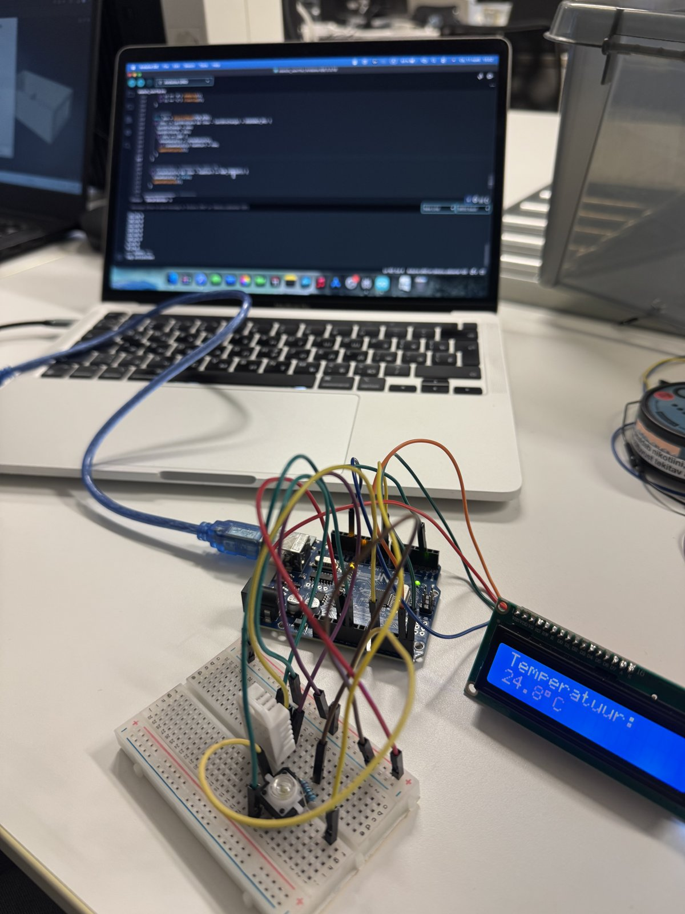
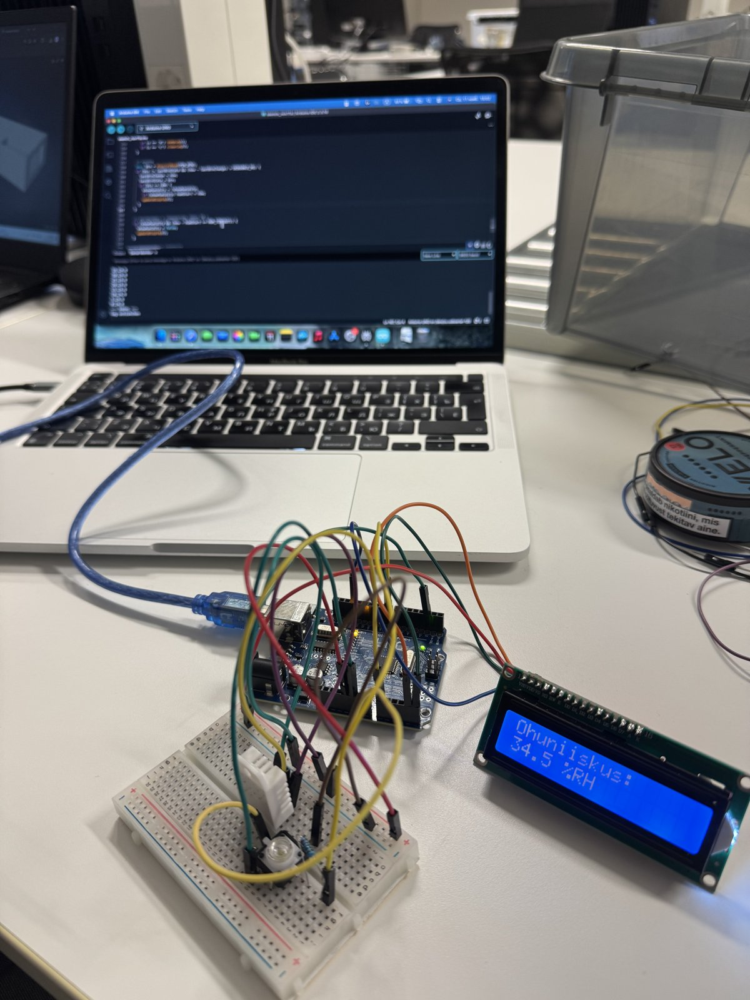

# Kodune temperatuuri- ja õhuniiskuse andur

## Projekti eesmärk ja loodava seadme lühikirjeldus

Projekti eesmärk on luua kodune temperatuuri- ja õhuniiskuse mõõteseade, mis kuvab mõõtmistulemusi LCD-ekraanil ja annab visuaalse hoiatuse, kui ruumi temperatuur langeb alla 22 °C. Seade on mõeldud kasutamiseks toas ning paigutatakse 3D-printeriga trükitud korpusesse, mis kaitseb elektroonikat ja annab seadmele korraliku välimuse.

Seade kasutab DHT22 andurit ruumi temperatuuri ja suhtelise õhuniiskuse mõõtmiseks. Mõõtmistulemus kuvatakse 16×2 I2C LCD-ekraanil, mille juhtimiseks kasutatakse PCF8574 adapterit.

Vaikimisi kuvab ekraan ruumi temperatuuri. Kui kasutaja vajutab korpuse peal olevat nuppu, vahetub kuvatav väärtus õhuniiskusele. Kui nuppu enam ei vajutata, läheb ekraan 30 sekundi pärast automaatselt tagasi temperatuuri kuvamisele. Kui kasutaja vajutab nuppu uuesti, lülitub ekraan kohe tagasi temperatuurile.

Sama nupp sisaldab LED-valgusdioodi. Kui mõõdetud temperatuur on alla 22 °C, hakkab nupu LED põlema. See annab kasutajale kohe visuaalse märku, et ruumi temperatuur on langenud liiga madalaks. Kui temperatuur tõuseb vähemalt 22 °C-ni, kustub LED automaatselt.

## Vajalik riistvara

| # | Komponent | Kogus | Kirjeldus | Pinge / toide | Roll projektis |
|---|-----------|------:|-----------|---------------|----------------|
| 1 | Arduino Uno R3 | 1 | ATmega328P põhine mikrokontrolleri plaat | Tööpinge 5 V; toide patareist (toitepesa või VIN, 7–12 V) | Loeb andurit, juhib LCD-d, nuppu ja LED-i, salvestab logi |
| 2 | 16×2 LCD-ekraan koos I2C-adapteriga | 1 | Tähemärgid: 16 × 2; PCF8574 I/O adapter (aadress 0x27 või 0x3F) | 5 V DC | Kuvab temperatuuri ja õhuniiskuse väärtused |
| 3 | DHT22 / AM2302 andur | 1 | Digitaalne temperatuuri- ja õhuniiskuseandur | 3,3–5,5 V DC | Mõõdab temperatuuri ja suhtelist õhuniiskust |
| 4 | LED-iga nupp (taktvõti) | 1 | Hetkeline kontakt, sisseehitatud LED | 5 V loogikaga ühilduv | Kuvarežiimi vahetamine; LED annab madala temperatuuri hoiatuse |
| 5 | Takisti 220 Ω | 1 | LED-i eeltakisti | – | Piirab LED-i voolu |
| 6 | Arendusplaat ja ühendusjuhtmed | – | – | – | Prototüübi ühendamine |

Kogu riistvara on ülikoolis olemas.

## Toide

- Arduino saab toite patareist (toitepesa või VIN-viigu kaudu, 7–12 V).
- Koodi üleslaadimise ja logi lugemise ajal saab toite ka USB-kaabli kaudu.
- LCD ja DHT22 saavad toite Arduino 5 V viigust.

## Ühendused

| Komponent | Komponendi viik | Arduino viik |
|-----------|-----------------|--------------|
| DHT22 | VCC | 5V |
| DHT22 | DATA | A0 |
| DHT22 | GND | GND |
| LCD (I2C) | VCC | 5V |
| LCD (I2C) | GND | GND |
| LCD (I2C) | SDA | A4 |
| LCD (I2C) | SCL | A5 |
| Nupp | kontakt 1 | D2 (sisemine pull-up) |
| Nupp | kontakt 2 | GND |
| Nupu LED | anood (+) | D8 → 220 Ω takisti |
| Nupu LED | katood (−) | GND |

Skeem on ka [Tinkercadis](https://www.tinkercad.com/things/b6j5CdlhvuZ-andur?sharecode=VAT-XcqrCM38mbUm0xEQI5R4AGCoupYCzonJ24NrogU).

## Nõuded loodavale seadmele

| # | Nõue | Kirjeldus |
|---|------|-----------|
| 1 | Temperatuuri mõõtmine | Seade peab mõõtma ruumi temperatuuri DHT22 anduri abil ja kuvama tulemuse LCD-ekraanil. |
| 2 | Õhuniiskuse mõõtmine | Seade peab mõõtma suhtelist õhuniiskust ja võimaldama seda väärtust ekraanil kuvada. |
| 3 | Vaikimisi kuvamine | Pärast seadme käivitamist kuvab ekraan vaikimisi temperatuuri. |
| 4 | Kuvarežiimi vahetamine | Korpuse peal oleva nupu vajutamisel vahetub ekraan temperatuuri kuvamiselt õhuniiskuse kuvamisele. |
| 5 | Automaatne tagasipöördumine | Kui õhuniiskust kuvatakse 30 sekundit ja nuppu ei vajutata, lülitub ekraan automaatselt tagasi temperatuurile. |
| 6 | Korduv nupuvajutus | Kui kasutaja vajutab nuppu uuesti, lülitub ekraan kohe tagasi temperatuuri kuvamisele. |
| 7 | Madala temperatuuri hoiatus | Kui temperatuur on alla 22 °C, peab nupus olev LED-valgusdiood süttima. |
| 8 | LED-i automaatselt väljalülitamine | Kui temperatuur tõuseb vähemalt 22 °C-ni või sellest kõrgemaks, peab nupus olev LED kustuma. |
| 9 | Kaitsekorpuse paigaldamine | Elektroonika ja ekraan peavad paiknema 3D-printeriga trükitud korpuses, mis kaitseb neid mehaaniliste kahjustuste eest. |
| 10 | Kasutatavus | Seade peab olema lihtne kasutada: kasutaja peab saama väärtusi vaadata ja kuvarežiimi vahetada ühe nupuga. |
| 11 | Stabiilne töö | Seade peab töötama stabiilselt 5 V toitel ning DHT22 andurit ei tohi lugeda sagedamini kui kord 5 minuti jooksul. |
| 12 | Nupu ja LED-i töökindlus | Nupp peab olema ühendatud Arduino digitaalsisendisse koos sisemise pull-up takistiga ning LED peab olema kaitstud sobiva eeltakistiga. |

## Tarkvara

Kood asub failis [`andur/andur.ino`](andur/andur.ino).

### Vajalikud teegid

Paigalda Arduino IDE-s (*Tools → Manage Libraries*):

- **DHT sensor library** (Adafruit) – koos sellega paigaldub ka *Adafruit Unified Sensor*
- **LiquidCrystal I2C** (Frank de Brabander)

`EEPROM` ja `Wire` kuuluvad Arduino standardteekide hulka.

### Paigaldamine

1. Ava Arduino IDE-s fail `andur/andur.ino`.
2. Vali plaadiks *Arduino Uno* ja õige port.
3. Laadi kood üles (*Upload*).
4. Kui LCD jääb tühjaks, muuda koodis I2C-aadress `0x27` → `0x3F`.

### Töö loogika

- Andurit loetakse iga 5 minuti järel. Kui lugemine ebaõnnestub, proovitakse 5 sekundi pärast uuesti.
- Anduri vea korral kuvatakse ekraanil „Anduri viga“ ja nupu LED vilgub.

### Temperatuurilogi (EEPROM)

Iga mõõdetud temperatuur salvestatakse Arduino EEPROM-mällu (ringpuhver, 511 kirjet ≈ 42 tundi 5-minutilise intervalliga). Logi säilib ka toite kadumisel.

Serial Monitoris (9600 baud) saab kasutada käske:

| Käsk | Toiming |
|------|---------|
| `d` | Väljastab logi CSV-kujul (`sek_tagasi,temp_C`), vanimast uusimani |
| `c` | Kustutab kogu logi |

Märkus: `sek_tagasi` arvutatakse eeldusel, et seade on töötanud katkestusteta – toitekatkestuse korral ei ole vanemate kirjete ajad täpsed.

## Korpus

3D-prinditava korpuse failid asuvad kaustas [`3d/`](3d/):

- [`3d/box.stl`](3d/box.stl) – korpus
- [`3d/lid.stl`](3d/lid.stl) – kaas
- [`3d/hatch.stl`](3d/hatch.stl) – luuk

## Fotod

Prototüüp arendusplaadil (12.11):

| Temperatuuri vaade | Õhuniiskuse vaade |
|---|---|
|  |  |
